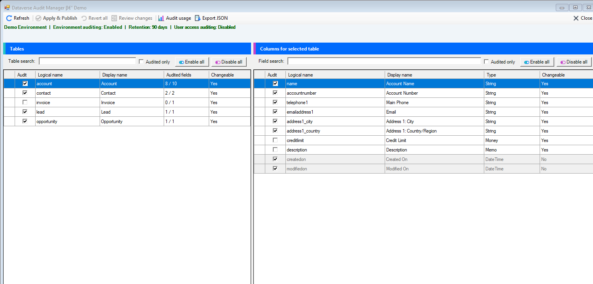
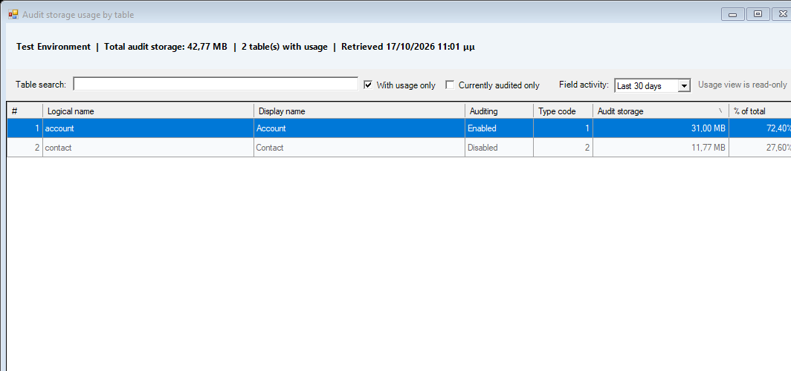
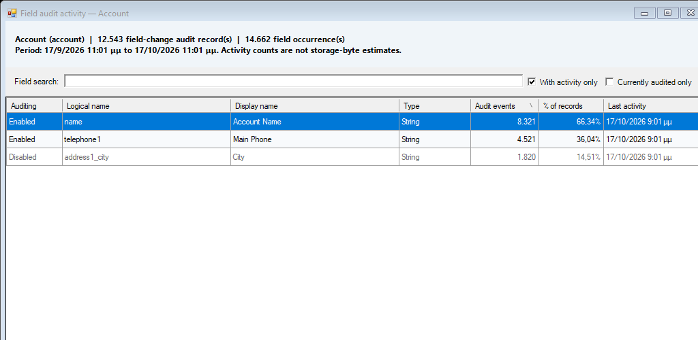

<p align="center">
  
</p>

# Dataverse Audit Manager for XrmToolBox

Inspect, configure, and manage Microsoft Dataverse auditing at environment, table, and column level from XrmToolBox.

The plugin uses the active XrmToolBox connection. It does not store connection strings or credentials and does not send telemetry.

> [!CAUTION]
> Audit-history deletion is permanent. Review the selected table and cutoff carefully, test in a nonproduction environment, and follow your organization's retention and compliance policies.

## Screenshots



<details>
<summary>Audit storage and field activity</summary>





</details>

All screenshots use synthetic data.

## Features

- Uses the active XrmToolBox connection; no connection string is stored by the plugin
- Displays environment auditing, retention, and user-access auditing status
- Searchable, sortable table and column grids with audited-only filters
- Loads table metadata first, then retrieves and caches fields only when a table is selected
- Enables or disables all visible, changeable tables or columns
- Stages configuration changes locally until **Apply & Publish** is selected
- Reviews pending changes in a compact, filterable list with individual and revert-all actions
- Requires confirmation before applying, reverting all, or deleting audit history
- Batches metadata operations, skips no-op updates, publishes affected tables once, and verifies effective settings afterward
- Protects managed settings and identifies platform-controlled virtual fields
- Shows per-table audit storage through Dataverse `GetAuditStorageDetails`
- Provides date-bounded field-activity drill-downs based on audit attribute masks
- Submits guarded, asynchronous audit cleanup for a selected table with an optional cutoff date, typed table-name confirmation, and a final confirmation defaulting to **No**
- Exports the complete effective audit configuration to JSON

## Requirements and permissions

- Windows and a current XrmToolBox installation
- A Microsoft Dataverse environment
- Permission to read table/column metadata and audit information
- Appropriate Dataverse customization privileges to change audit settings
- Appropriate audit and bulk-delete privileges to submit audit-history cleanup jobs

Dataverse remains the authority for all permission checks. Features for which the connected user lacks privileges return the corresponding Dataverse error.

## Installation

### XrmToolBox Tool Library

Once the package is listed, open **Tool Library** in XrmToolBox, search for **Dataverse Audit Manager**, and select **Install**.

### Manual installation

1. Download `DataverseAuditManager.XrmToolBox.dll` from the latest GitHub release.
2. Close XrmToolBox.
3. Copy the DLL into the `Plugins` directory beside `XrmToolBox.exe`.
4. Start XrmToolBox and open **Dataverse Audit Manager**.
5. Connect to the desired environment and select **Refresh**.

## Safety behavior

Changing an auditing checkbox only stages the change in the UI. Dataverse is not modified until **Apply & Publish** is selected and the confirmation dialog is accepted.

The apply operation uses:

- `ExecuteMultipleRequest` to batch metadata retrievals and updates
- `UpdateEntityRequest` for table auditing
- `UpdateAttributeRequest` for column auditing
- `PublishXmlRequest` for affected tables

After publishing, the plugin re-reads every changed table and field from published metadata. Any setting Dataverse did not retain is restored to its effective value in the grid and reported as a verification warning.

The **Audit usage** grid and field-activity drill-down are read-only. Field activity is loaded only on request, is date-bounded, and scans at most the latest 100,000 matching audit records. It reports audit activity, not estimated storage bytes per field.

Audit deletion is isolated in a separate workflow. It defaults to deleting history older than 90 days. The user must select a table, choose whether to apply a cutoff, type the table logical name, and accept an irreversible-operation warning that defaults to **No**. Dataverse runs the resulting `BulkDeleteRequest` asynchronously. Deleted history cannot be recovered, and storage reporting may not update immediately after the job finishes.

If an operation fails partway through, refresh the relevant view to obtain the server's effective state before retrying.

## Build from source

The plugin targets .NET Framework 4.8.

```powershell
dotnet restore --configfile NuGet.Config
dotnet build DataverseAuditManager.slnx --configuration Release --no-restore
```

Output:

```text
bin\Release\net48\DataverseAuditManager.XrmToolBox.dll
```

To deploy a local build, close XrmToolBox and run:

```powershell
.\Deploy.ps1 -XrmToolBoxPath "C:\Path\To\XrmToolBox"
```

Local installations are categorized as **Configuration**, **Data**, and **Security**. If XrmToolBox rebuilds its local manifest, close it and run:

```powershell
.\Set-PluginCategories.ps1
```

## Logo assets

Logo source and generated icons are under `assets`:

- `pobuca-icon.svg`
- `pobuca-icon-512.png`
- `audit-manager-logo-512.png`
- `audit-manager-logo-80.png`
- `audit-manager-logo-32.png`

Run `python assets/generate_logo.py` to regenerate the plugin PNG files and embedded `LogoResources.cs` constants.

## Contributing and support

- Read [CONTRIBUTING.md](CONTRIBUTING.md) before submitting a pull request.
- Use GitHub issues for sanitized bug reports and feature requests.
- Report vulnerabilities privately as described in [SECURITY.md](SECURITY.md).
- See [CHANGELOG.md](CHANGELOG.md) for release history.

Never publish credentials, access tokens, environment URLs, customer records, or audit exports in an issue.

## License and trademarks

The source code is available under the [MIT License](LICENSE).

Pobuca names and logos are not licensed under the MIT License. See [TRADEMARKS.md](TRADEMARKS.md). Microsoft, Dataverse, Power Platform, Dynamics 365, and XrmToolBox are trademarks of their respective owners. This project is not affiliated with or endorsed by Microsoft or the XrmToolBox maintainers.

## Development references

- [XrmToolBox developer documentation](https://www.xrmtoolbox.com/documentation/for-developers/)
- [Debug an XrmToolBox tool](https://www.xrmtoolbox.com/documentation/for-developers/debug/)
- [Deploy a tool to the Tool Library](https://www.xrmtoolbox.com/documentation/for-developers/deploy-your-plugin-in-plugins-store/)
